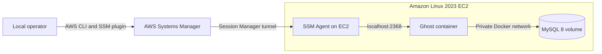

# Ghost Blog One-Click AWS Deployment

This directory provides a demo-oriented, single-instance AWS deployment of Ghost CMS with MySQL 8. It uses Amazon Linux 2023, Docker Compose, and AWS Systems Manager Session Manager. An EC2 instance is launched with no public inbound rules: administrators connect only through an encrypted SSM port-forwarding tunnel to Ghost on port 2368.

The implementation intentionally contains no SSH service, key pair, load balancer, database service, or public web server. Docker publishes Ghost on `127.0.0.1:2368` inside the EC2 instance, so it is reachable only locally or through the SSM tunnel.

## Architecture



The architecture has one public-subnet EC2 instance with a public IP only to make SSM and package access straightforward. The Security Group has no inbound rules. Ghost listens on host loopback only. Docker creates an internal network for Ghost-to-MySQL traffic. A named MySQL volume persists the database independently of containers.

## Directory structure

```text
one-click-deploy/
├── deploy.sh                 Deploy IAM, Security Group, and EC2 resources
├── connect.sh                Start the SSM port-forwarding session
├── cleanup.sh                Terminate and remove confidently identified resources
├── docker-compose.yml        Ghost, MySQL, volumes, network, and health checks
├── scripts/install.sh        Amazon Linux bootstrap and Docker startup
├── README.md                 Deployment and operations documentation
└── .gitignore                Secret, log, state, and temporary-file exclusions
```

## Prerequisites

- Linux or macOS with Bash
- AWS CLI v2
- AWS Session Manager plugin
- Docker Compose syntax validator, if local validation is desired
- AWS credentials with permission to create/use the resources below
- A default VPC and at least one default subnet in the selected AWS Region

This implementation requires a default VPC and selects its default subnet. It does not create a VPC or NAT gateway.

### AWS permissions

The caller needs permission for EC2, IAM, SSM parameter lookup, and Session Manager actions, including:

- `sts:GetCallerIdentity`
- `iam:GetRole`, `iam:CreateRole`, `iam:AttachRolePolicy`, `iam:CreateInstanceProfile`, `iam:GetInstanceProfile`, `iam:AddRoleToInstanceProfile`
- `ec2:DescribeVpcs`, `ec2:DescribeSubnets`, `ec2:DescribeSecurityGroups`, `ec2:CreateSecurityGroup`, `ec2:RevokeSecurityGroupIngress`, `ec2:DescribeInstances`, `ec2:RunInstances`, `ec2:TerminateInstances`, `ec2:DescribeTags`
- `ssm:GetParameters`, `ssm:StartSession`

Cleanup additionally needs IAM removal actions and `ec2:DeleteSecurityGroup`. Restrict IAM permissions to the fixed project role/profile names where possible.

## Deploy

Configure credentials and a default Region, for example:

```bash
aws configure
aws sts get-caller-identity
```

Deploy with the configured Region:

```bash
chmod +x one-click-deploy/deploy.sh one-click-deploy/connect.sh one-click-deploy/cleanup.sh
./one-click-deploy/deploy.sh
```

Or select a Region explicitly:

```bash
./one-click-deploy/deploy.sh --region us-east-1
```

The script:

1. Validates AWS CLI availability and credentials.
2. Reuses or creates `ghost-blog-one-click-ssm-role`, tagged `Project=GhostBlogOneClick`.
3. Attaches `AmazonSSMManagedInstanceCore`, which permits the EC2 SSM agent to register and receive sessions.
4. Reuses or creates `ghost-blog-one-click-profile` and associates the project role.
5. Creates or verifies `ghost-blog-one-click-sg`. An existing project-tagged Security Group has all inbound rules removed.
6. Resolves the latest Amazon Linux 2023 AMI and a default subnet.
7. Launches a `t3.micro` instance with IMDSv2 required and a project/Name tag.
8. Supplies the Compose file and install script through EC2 user data.

Wait several minutes for Docker and Ghost to initialize. The script waits only for EC2 running state, not application readiness.

## Connect through SSM

Install the Session Manager plugin and confirm that the instance appears in SSM. Then:

```bash
./one-click-deploy/connect.sh --region us-east-1 i-0123456789abcdef0
```

Keep that terminal open. In a second terminal or browser, open:

**http://localhost:2368**

The script forwards local TCP port 2368 to port 2368 on the instance. Ghost is configured to publish only to `127.0.0.1` in the EC2 host, and the Security Group has no inbound rules. The tunnel terminates the session without exposing Ghost over SSH or HTTP.

## Why SSH is disabled

The deployment creates no SSH inbound rule and adds no key pair. Amazon Linux may expose an SSH daemon as an OS default, but the EC2 Security Group prevents inbound SSH at the network boundary. Session Manager provides controlled shell access when enabled separately and provides the encrypted port-forwarding session used by this implementation. This reduces credential and key-management requirements and avoids port 22 entirely.

## Application configuration

The supplied Compose configuration defines:

- **Ghost 5 Alpine:** the web application and an HTTP health check. Restarting it does not remove its named content volume.
- **MySQL 8.0:** the database. Restart and health policies prevent Ghost from starting until MySQL reports ready.
- **`mysql-data`:** a named Docker volume that persists database files across container and service restarts.
- **`ghost-content`:** a named Docker volume that persists Ghost content.
- **`ghost-internal`:** an internal Docker network. Ghost and MySQL communicate through it; MySQL is not published to the host.
- **Host bind:** `127.0.0.1:2368:2368`, so the host loopback is the only listener.

The compose file contains clearly demo-only credentials:

- MySQL database/user: `ghost`
- Ghost/MySQL password: `ghost-demo-password-change-me`
- MySQL root password: `ghost-demo-root-password-change-me`

Change these values and initialize a fresh database volume before any real use. Ghost's public URL is `http://localhost:2368`, matching the tunnel. Persisted data is in Docker volumes and is retained until explicitly removed.

To change configuration on the instance, connect through SSM or an approved SSM shell session, edit `/opt/ghost-blog/docker-compose.yml`, and run:

```bash
cd /opt/ghost-blog
docker compose up -d --force-recreate
```

There is no SSH-based workflow.

## Troubleshooting

- **SSM target is offline:** wait for the EC2 instance, SSM agent, and IAM profile to initialize. In AWS Console, open Systems Manager > Fleet Manager and verify an instance in the selected Region.
- **Session Manager plugin missing:** install AWS's Session Manager plugin for the operating system and rerun `connect.sh`.
- **Credentials or Region errors:** run `aws sts get-caller-identity` and verify `AWS_REGION` or `AWS_DEFAULT_REGION`.
- **Local port 2368 is occupied:** stop the process using it and rerun the connection script.
- **Ghost is not ready:** use SSM to run `docker compose -f /opt/ghost-blog/docker-compose.yml ps` and `docker compose ... logs`.
- **Docker or initialization failed:** inspect `/var/log/cloud-init.log` and `/var/log/cloud-init-output.log` on the instance.
- **No default VPC/subnet:** the script intentionally requires a default VPC. Provision a default VPC or modify the deployment script to select an explicitly audited VPC.
- **AWS IAM propagation:** after role/profile creation, wait briefly and rerun deployment if SSM registration occurs slowly.

## Cleanup

Run cleanup with the instance ID:

```bash
./one-click-deploy/cleanup.sh --region us-east-1 i-0123456789abcdef0
```

The script asks for explicit `yes` confirmation, terminates the tagged instance, waits for termination, and deletes only:

- a Security Group with both the fixed project name and `Project=GhostBlogOneClick` tag;
- the fixed instance profile only if it has the project tag;
- the fixed role only if it has the project tag.

Resources already absent are handled as warnings or left alone. Untagged or differently tagged resources are not removed. Docker volumes are local to the instance and become unavailable after EC2 termination. If preserving data, back it up before cleanup.

## Production security considerations

These demo defaults are not production-ready. Before production use:

- Replace demo passwords and store secrets in AWS Secrets Manager or SSM Parameter Store with encryption.
- Pin and regularly update the Ghost and MySQL container versions.
- Use an approved VPC architecture, private subnets, NAT or VPC endpoints, and least-privilege IAM.
- Add TLS termination, DNS, and controlled public access only if public access is required.
- Use backups and tested restore procedures for Docker named volumes or migrate MySQL to a managed database.
- Restrict Session Manager use with IAM conditions, logging, and CloudTrail.
- Enable SSM session logging and EC2 logs/metrics, patching, and vulnerability management.
- Use a durable AMI/container deployment strategy and instance storage design suitable for availability and recovery.
